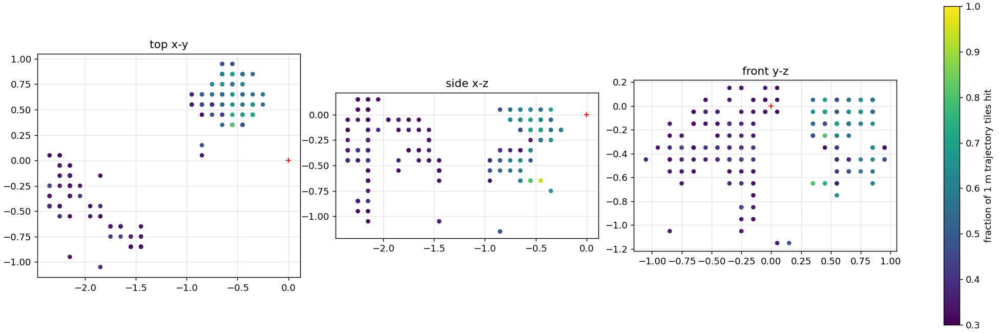
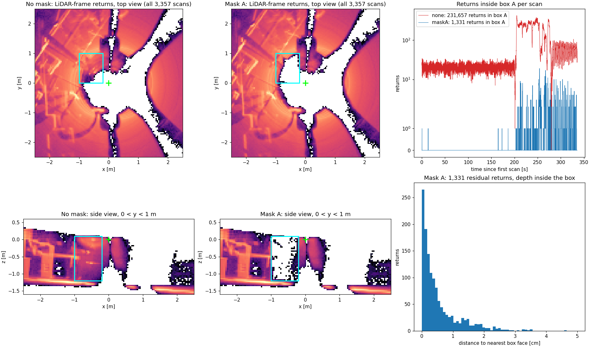
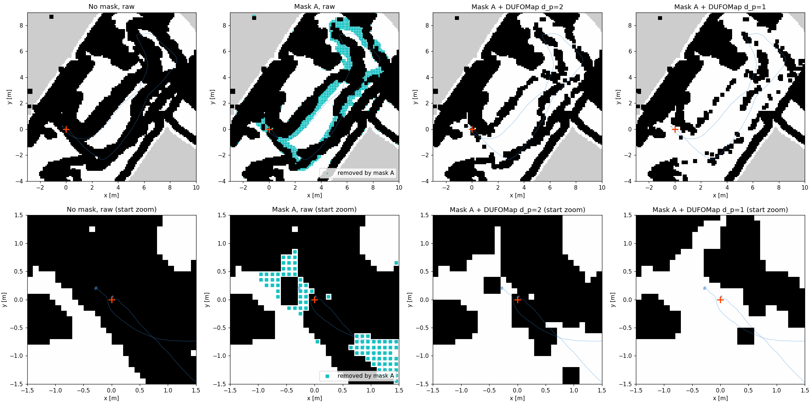

# 2026-11-05 随行吊架掩膜、分支统一与资源现状

适用于第二台 G1 的 `hang_A_02` 录包。吊架随 G1 移动，与雷达相对位置固定。DUFOMap 的离线清图流程见[实施记录](../../docs/superpowers/plans/2026-11-05-dufomap-sim.md)。

## 1. 结论

| 项目 | 状态 |
| --- | --- |
| 吊架定位 | 起点残点在补偿后的雷达坐标系里集中在左后下方，随 G1 移动 8–9 m 后位置不变，判定为随行吊架 |
| 掩膜 | FAST-LIO 新增 `preprocess.mask_boxes`，在倒装补偿后、去畸变和配准前剔除盒内点，默认不生效 |
| 掩膜效果 | A 盒内回波从 231,657 降到 1,331，残留点距盒面中位 0.3 cm；去掉的 1,207 个占用格 88.7% 距轨迹不到 1 m |
| 位姿影响 | 与无掩膜相比，射线起点偏差中位 6 mm、最大 3.3 cm |
| 起点通行性 | 仅掩膜时起点仍占用。掩膜加 DUFOMap `d_p=1` 后起点转为空闲，远离轨迹的 271 格是否属于静态结构待现场核对 |
| 双端验证 | 提交前 PC2/Foxy 与 4322/Humble 均编译通过，录包建图、`/map_save` 与 Open3D 定位初始化通过 |
| 分支 | Mac、4322、PC2 部署与云端统一到 `g1-slam`，云端默认分支改为 `g1-slam` |

## 2. 吊架范围与掩膜生效证明

把每帧 FAST-LIO body 点云按同时间戳位姿变回补偿后的雷达坐标系，统计离拟合地面 0.12 m 以上、距雷达 2.5 m 内的 10 cm 体素。按 G1 经过的 37 个 1 m 轨迹格计数，A 块在 32%–95% 的轨迹格中出现。B 块只在 32%–43% 中出现，未纳入掩膜。

| 块 | 雷达坐标系范围 x / y / z（m） | 处理 |
| --- | --- | --- |
| A | −1.0 ~ −0.2 / 0.0 ~ 1.0 / −1.2 ~ 0.1 | 掩膜 |
| B | −2.4 ~ −1.4 / −1.1 ~ 0.1 / −1.1 ~ 0.2 | 不掩膜 |



下图用同一二进制、同一录包回放两次，只改掩膜参数。左两列是 3,357 帧在雷达坐标系的累积回波，青框为 A 盒。右上是逐帧盒内回波数，右下是掩膜后残留点到最近盒面的距离。



| 回放 | A 盒内回波 | 含盒内回波的帧 | 残留点距盒面 中位 / p99 / 最大 |
| --- | ---: | ---: | --- |
| 无掩膜 | 231,657 | 3,353 / 3,357 | 11.1 / 36.1 / 40.0 cm |
| A 掩膜 | 1,331 | 467 / 3,357 | 0.3 / 2.7 / 4.6 cm |

掩膜作用于去畸变前的原始点，统计用的是去畸变后的点。帧内运动补偿会把点移动几厘米，残留点都贴着盒面，且集中在 200 s 后 G1 移动的时段。节点启动时打印 `Masking 1 LiDAR-frame boxes`。4322 上同一段 60 s 回放保存的地图，无掩膜 49,562 点，有掩膜 49,206 点。

## 3. 回放建图对比

三组全包回放共用同一二进制、地面平面、10 cm 栅格和 12 m 投影半径，二维图不做起点填补。起点回波指起点 0.35 m 内、离地 0.2–1.8 m 的回波。

| 回放 | 起点回波，原始累积 | 占用格，原始累积 | DUFOMap `d_p=2` 占用格 | 起点格 |
| --- | ---: | ---: | ---: | --- |
| 无掩膜 | 3,410 | 14,338 | 13,460 | 占用 |
| A | 27 | 13,241 | 12,385 | 占用 |
| A+B | 24 | 13,243 | 12,407 | 占用 |
| A，DUFOMap `d_p=1` | — | — | 11,223 | 空闲 |



第二列青色为 A 掩膜去掉的占用格，集中在轨迹左侧，与吊架在雷达 +y 侧一致。B 掩膜额外删去约 36 万个环境回波，起点和占用格几乎不变。相对 A 掩膜的原始累积，`d_p=2` 和 `d_p=1` 分别再删 856 和 2,018 个占用格，其中 66 和 271 格距轨迹超过 1.3 m。

启用方式如下，数值需写成浮点数。G1 相对吊架转向或改装吊具后，需要按第 2 节重新统计范围。

```bash
-p "preprocess.mask_boxes:=[-1.0,0.0,-1.2,-0.2,1.0,0.1]"
```

候选二维图位于 Mac 的 `g1_a_segment_2026-11-05/hang_A_02/dufomap_review/mask_review/maskA-dp1/dufomap-map/`，暂不作为导航地图。

## 4. 代码、分支与验证

`g1-slam` 在 `5532f03` 之后新增以下提交，已推送到 `origin/g1-slam`。

| 提交 | 内容 |
| --- | --- |
| `520ccf6` | FAST-LIO 帧尾取最晚点，`/map_save` 原子写入并报告失败，可选 IMU 朝向诊断 |
| `eef8bcf` | A 段采集脚本、单流探针，`walking_env.sh` 兼容 `set -u` |
| `f4a8d59` | 二维导出可调地面带、障碍带和投影半径 |
| `b672b66` | A 段进展与待验证项 |
| `405b5cb` – `c8200a5` | DUFOMap 离线清图、仿真验证、Foxy 采集、地面平面投影、`d_s`/`d_p` 参数 |
| `0ca4ad6` | `preprocess.mask_boxes` 雷达坐标系掩膜 |
| `95087d8` | 掩膜实验记录 |

提交前在两端独立目录 `~/ldy/review-verify` 编译 `fast_lio` 与 `open3d_loc`。运行用例先回放录包建图并调用 `/map_save`，再用保存的地图做 Open3D 定位初始化。掩膜分支启用 A 盒。

| 环境 | 录包 | 编译 | 定位 fitness，主仓库提交 / 掩膜分支 |
| --- | --- | --- | --- |
| PC2，Foxy/aarch64 | `static_01`，不开倒装补偿 | 两树均通过，约 3 分 20 秒 | 0.910 / 0.938 |
| 4322，Humble/x86 | `hang_A_02` 前 60 s，倒装补偿 | 两树均通过，约 3 分 15 秒 | 0.993 / 0.994 |

`static_01` 回放触发了 IMU 朝向诊断，Z 轴比力为 −1 g，与该包不开补偿的设置一致。验证中曾因测试脚本残留进程在同一 ROS 域重复播包，导致一次建图发散。清理后重跑通过。

## 5. 三端资源位置

| 位置 | 内容 | 性质 |
| --- | --- | --- |
| Mac `~/Desktop/code/SLAM/FAST_LIO_LOCALIZATION_HUMANOID` | `g1-slam` 仓库，`.deps` 约 752 MB，`tmp/g1_real_data` 含 `static_01` 副本 | 主仓库 |
| Mac `~/Desktop/code/SLAM/g1_a_segment_2026-11-05/hang_A_02` | `bags` 1.3 GB 原始录包，`maps`、`preview`、`records`，`dufomap_review` 约 110 MB | 数据与中间产物 |
| Mac `~/Desktop/code/SLAM/g1_dufomap_4322_preview` | 仿真截图与指标，约 2.3 MB | 演示产物 |
| PC2 `~/ldy/FAST_LIO_LOCALIZATION_HUMANOID` | rsync 部署副本，非 git。源码同步到 `g1-slam`，`fast_lio` 与 `open3d_loc` 已重编，依赖齐全，掩膜参数可加载 | 部署 |
| PC2 `~/ldy/g1_real_data` | `bags` 的 `hang_A_02`、`orient_01`、`orient_02`、`static_01`，以及 `maps`、`records`、`config`，约 2.4 GB | 正式数据 |
| PC2 `~/ldy/vendor`、`~/ldy/open3d141_arm.zip` | ARM Open3D 解包目录与原始压缩包 | 依赖 |
| PC2 `~/ldy/{review-verify,dufomap-foxy-review,a-segment-review.rnAh6N,g1-nav-*}` | 隔离构建与验证目录 | 临时 |
| 4322 `~/ldy/FAST_LIO_LOCALIZATION_HUMANOID` | git 仓库，`g1-slam`，安装目录仍为 11-04 构建 | 部署 |
| 4322 `~/ldy/g1_a_replay/hang_A_02` | `hang_A_02` 录包副本 1.3 GB，预览包与二维图 | 数据副本 |
| 4322 `~/ldy/{dufomap-sim.WWmdzT,dufomap-real-hang-A-02,dufomap-mask-review,review-verify,FAST_LIO-humble-review.qR6RmX,g1-nav-*}` | 仿真、回放、对照与验证目录，约 2.3 GB | 临时 |
| 云端 `lidongyao95/FAST_LIO_LOCALIZATION_HUMANOID` | 仅 `g1-slam`，为默认分支。原 `main` 是上游 README 更新，保留在 `deepglint/FAST_LIO_LOCALIZATION_HUMANOID` | 远端 |

4322 的 `~/ldy` 还有 `robotwin`、`NavDP`、`_wrtc` 等其他项目目录，不属于本仓库。

## 6. 待办

| 项目 | 下一步 |
| --- | --- |
| `d_p=1` 远处删格 | 到现场核对 271 个距轨迹 1.3 m 以上的删除格是否为墙、门框或家具 |
| 吊架状态变化 | 转向、换吊具或换安装位后重新统计掩膜范围，并记录在录包登记中 |
| 4322 部署安装 | 停止旧会话后按 `g1-slam` 重编 `install/` |
| 临时资源 | 先归档被文档引用的日志和指标，再删除临时目录 |
