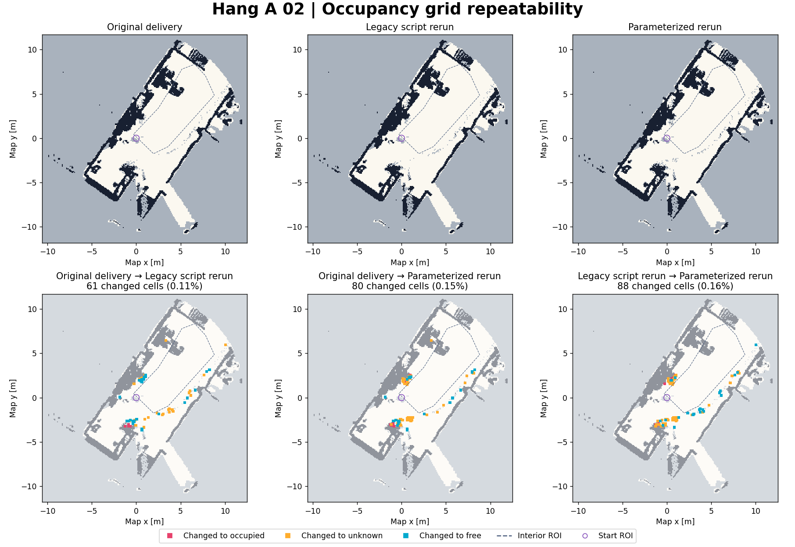
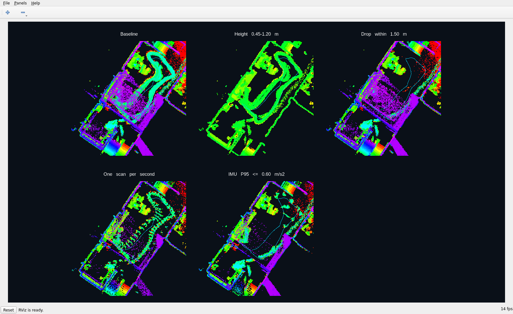
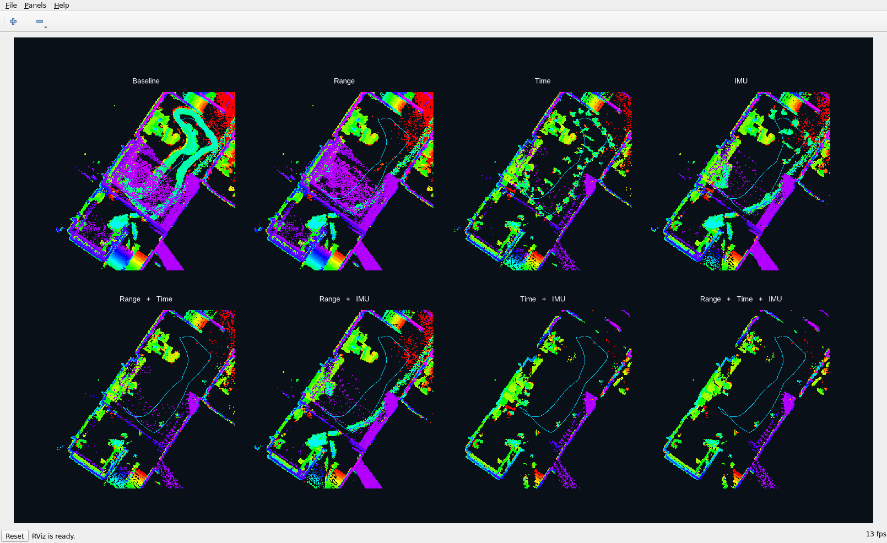

# Hang A 02 点云过滤参数

入口是 `scripts/hang_a02/plaster-map/generate.py`。它读取 FAST-LIO 去畸变点云、同时间戳的位姿和 IMU 评分，用同一批静态回波生成石膏网格的源点云和 Nav2 二维地图。参数每次运行独立生效，默认值复现上一轮交付的地图。

## 参数

| 参数 | 默认值 | 含义 |
|---|---:|---|
| `--height-min` / `--height-max` | `-0.15` / `4.5` m | 保留闭区间内的点。高度是相对拟合地面的有符号距离。 |
| `--near-radius` | `1.5` m | 剔除每帧中距机器人水平距离小于等于该值的点。设为 `0` 关闭。 |
| `--keep-near-ground` / `--no-keep-near-ground` | 保留 | 默认让离拟合地面不足 0.15 m 的点通过近距门限，为二维空闲区域保留观测。高度和地图半径仍适用。 |
| `--sample-period` | `0` s | 以首帧为时间原点，每个时间桶取第一帧。`0` 保留全部帧。 |
| `--imu-max-accel` | `0.6` m/s² | 保留去重力加速度 P95 小于等于阈值的帧。评分使用帧末前 100 ms，至少需要 15 个 IMU 样本。 |
| `--no-imu-filter` | 未指定 | 指定后跳过 IMU 门限，包括缺少足够 IMU 样本的帧。 |
| `--max-map-radius` | `12` m | 以地图原点为中心裁剪水平范围。设为 `0` 关闭裁剪，二维输出仍受既定栅格边界限制。 |
| `--dufo-d-s` / `--dufo-d-p` | `0.2` m / `1` 体素 | DUFOMap 的传感器噪声裕量和位姿不确定性裕量。 |

DUFOMap 用全量配对帧建立动态判别。输出时先取时间桶首帧，再应用 IMU 门限，最后对静态回波应用逐点过滤。首帧未通过 IMU 时，该时间桶不补取后续帧。二维投影的障碍高度带仍为离地 0.20–1.80 m，占用格至少需要 3 个不同扫描帧命中。

## 在 4322 离线运行

使用已有扫描和 `grids.npz`。若重新采集数据，先为同一批扫描生成配对证据，不能直接复用这轮的位姿和 IMU 评分。每次在新目录生成结果。

```bash
repo="$HOME/ldy/FAST_LIO_LOCALIZATION_HUMANOID"
evidence="$HOME/ldy/hang-a02-filter-comparison/grids.npz"
export PYTHONPATH="$HOME/ldy/dufomap-sim.WWmdzT/deps"
out=$(mktemp -d "$HOME/ldy/hang-a02-filter.XXXXXX")
cd "$out"

# 复现近距 + IMU 候选图
python3 "$repo/scripts/hang_a02/plaster-map/generate.py" \
  --evidence "$evidence" --near-radius 1.5 --imu-max-accel 0.6

# 三项叠加时，在另一个新目录执行上面的命令并追加 --sample-period 2
```

`--scans` 和 `--floor-metadata` 可以指定配对扫描目录和带 `floor_fit` 的 JSON。运行 `--help` 可查看完整参数。结果包括 `clean.pcd`、`map.yaml`、`map.pgm` 和 `metadata.json`，后者记录实际生效参数和保留帧数。需要石膏预览时，在同一输出目录使用 4322 上带 scikit-image 的 Python。

```bash
"$HOME/anaconda3/bin/python" "$repo/scripts/hang_a02/plaster-map/render.py"
```

对比参数时同时检查中央残点、起点和四周障碍物。每 2 秒取一帧会明显降低外围覆盖。近距半径越大，机器人附近的真实障碍回波也越容易被剔除。

## 二维图重跑差异



上排按顺序是最初交付、旧脚本重跑、参数化脚本按默认值重跑。下排是两两逐格比较。粉色变为占用，橙色变为未知，青色变为空闲。虚线是中央统计区，紫圈是起点周围 0.35 m。三份图的尺寸、坐标原点和分辨率一致，均为 231 × 235 格、0.10 m/格。

| 对比 | 全图变动 | 中央变动 | 起点圈变动 |
|---|---:|---:|---:|
| 最初交付 → 旧脚本重跑 | 61 格（0.11%） | 0 | 0 |
| 最初交付 → 参数化默认重跑 | 80 格（0.15%） | 1 | 0 |
| 旧脚本重跑 → 参数化默认重跑 | 88 格（0.16%） | 1 | 0 |

差异集中在部分结构边缘和零散回波附近。最初交付到参数化重跑的 80 格中，**79 格涉及未知状态，1 格从空闲变成占用**。该格中心在地图坐标 `(0.95, 2.55) m`，三次运行均有 796 帧地面回波，但障碍命中分别为 0、1、4 帧。0 帧时它满足空闲条件，1 帧时落为未知，4 帧超过 3 帧占用门限。这解释了少量回波差别怎样变成离散的地图状态变化。

已核对默认 IMU 选帧和逐点过滤条件与旧脚本一致。旧脚本自身重跑也有差异，且差异在二维投影前的障碍命中证据中已经可见。当前证据将差异定位到送入二维分类的回波支持数量，DUFOMap 内部造成波动的具体机制仍待定位。

逐格统计见 [JSON](assets/hang_a02_filters/hang_a02_grid_rerun.json)。三份地图保存在 4322，可用以下命令重画。

```bash
cd "$HOME/ldy/hang-a02-filter-comparison"
"$HOME/anaconda3/bin/python" "$repo/scripts/hang_a02/plaster-map/compare_reruns.py" \
  plaster-map parameters-legacy-check parameters-check.6M6U96/default \
  --out rerun-report
```

## 彩虹对比图与选参





- [`compare.py`](../scripts/hang_a02/compare.py) 扫描高度、近距、时间、IMU 各三档，输出 `grids.npz`、代表档位的 `cloud-*.npy`。[`render.py`](../scripts/hang_a02/render.py) 输出逐档密度图和统计，采用固定的 10 cm 网格与共同的对数色标，颜色表示每格回波数。
- [`rviz_review.py`](../scripts/hang_a02/rviz_review.py) 将离地高度写到 Z 轴，按 8 cm 体素保留显示点，把各档平移到同一窗口中。[`review.rviz`](../scripts/hang_a02/review.rviz) 用 `AxisColor` 按 Z 轴显示彩虹色，各档共用 **0.12–2.50 m** 的颜色范围和俯视尺度。青线是机器人轨迹。
- [`combined/`](../scripts/hang_a02/combined/) 使用同样的绘图口径展示近距 1.5 m、每 2 秒一帧、IMU P95 ≤ 0.6 m/s² 的所有组合。单项截图里的时间档是每 1 秒一帧。

### 复现对比

在 4322 上准备已有的原始录包、配对扫描及拟合地面文件。运行任一组时使用独立输出目录。组合图把下面的 `suite` 路径改为 `"$suite/combined"`。

```bash
suite="$repo/scripts/hang_a02"
out=$(mktemp -d "$HOME/ldy/hang-a02-sweep.XXXXXX")
cd "$out"
python3 "$suite/compare.py"
python3 "$suite/render.py"

source /opt/ros/humble/setup.bash
export ROS_LOCALHOST_ONLY=1 ROS_DOMAIN_ID=147
export DISPLAY=:0 __NV_PRIME_RENDER_OFFLOAD=1 __GLX_VENDOR_LIBRARY_NAME=nvidia
python3 "$suite/rviz_review.py" &
publisher=$!
rviz2 -d "$suite/review.rviz" &
rviz_pid=$!
glxinfo -B | grep 'OpenGL renderer'
nvidia-smi
# RViz 初始化后，在进程表核对上面的 rviz_pid，再抓取 RViz 窗口。
# 结束查看后关闭 RViz 和 publisher。
```

### 如何用图选参

先看青色轨迹周围的残点和外围结构是否连续，再看同一中央 ROI 内的有回波格数。时间抽样会同时降低真障碍和残点的回波数，因此还要看空间覆盖。彩虹图用于观察高度和轮廓，密度图用于比较回波支持，最终用二维图检查空闲、占用和未知状态。

| Hang A 02 组合 | 中央有回波格 | 起点圈有回波格 | 画面表现 |
|---|---:|---:|---|
| 基线 | 2,703 | 30 | 中央沿轨迹有连续点带 |
| 近距 + IMU | 342 | 8 | 中央残点明显减少，外围轮廓较连贯 |
| 近距 + 时间 | 222 | 5 | 中央更干净，外围点更稀 |
| 时间 + IMU | 59 | 0 | 起点圈无回波，部分边缘断开 |
| 三项全开 | 24 | 0 | 中央最干净，外围覆盖进一步降低 |

这轮候选导航图从 **1.5 m 近距 + 0.6 m/s² IMU** 开始，保留近处地面并关闭时间降采样。对比图的统计取自共同高度带内的原始过滤结果，最终导航图还经过 DUFOMap、地面豁免和栅格分类。每次改参数后应以新导出的二维图复核起点、墙边和通道。
